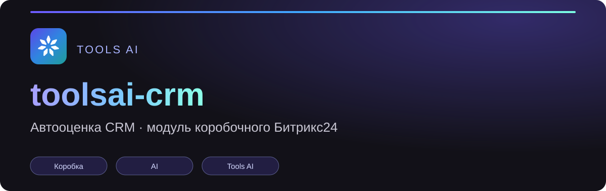

  

[![Tools AI](https://img.shields.io/badge/Tools%20AI-%D1%81%D0%B5%D0%BC%D0%B5%D0%B9%D1%81%D1%82%D0%B2%D0%BE-4B3CD0?style=flat&labelColor=121118&logo=data:image/svg%2bxml;base64,PHN2ZyB4bWxucz0iaHR0cDovL3d3dy53My5vcmcvMjAwMC9zdmciIGZpbGw9Im5vbmUiIHZpZXdCb3g9IjAgMCAyNCAyNCI+PHBhdGggZmlsbD0iI2ZmZiIgZD0iTTguNzk2LDEyLjA2OCBROS4wOTcsMTIuMTE0IDkuMjY4LDEyLjM2NSBROS40MzIsMTIuNjA1IDkuMzc4LDEyLjg5IFE5LjMyNCwxMy4xNzUgOS4wODUsMTMuMzM4IEw2LjE1NSwxNS4zMzggUTUuOTI3LDE1LjQ5MyA1LjY1NSwxNS40NTIgTDIuMTQ1LDE0LjkyMiBRMS44NDUsMTQuODc3IDEuNjczLDE0LjYyNiBRMS41MDksMTQuMzg3IDEuNTYyLDE0LjEwMiBRMS42MTUsMTMuODE3IDEuODU0LDEzLjY1MyBMNC43ODQsMTEuNjQzIFE1LjAxMywxMS40ODYgNS4yODYsMTEuNTI4IFogTTE0LjkxNSwxMy4zMzggUTE0LjY2NCwxMy4xNjcgMTQuNjE4LDEyLjg2NiBRMTQuNTc0LDEyLjU4IDE0Ljc0NiwxMi4zNDYgUTE0LjkxNywxMi4xMTIgMTUuMjA0LDEyLjA2OCBMMTguNzE0LDExLjUyOCBRMTguOTg3LDExLjQ4NiAxOS4yMTYsMTEuNjQzIEwyMi4xNDYsMTMuNjUzIFEyMi4zOTcsMTMuODI1IDIyLjQ0MiwxNC4xMjUgUTIyLjQ4NSwxNC40MTIgMjIuMzEzLDE0LjY0NiBRMjIuMTQxLDE0Ljg3OSAyMS44NTUsMTQuOTIyIEwxOC4zNDUsMTUuNDUyIFExOC4wNzMsMTUuNDkzIDE3Ljg0NSwxNS4zMzggWiBNMTIuNjUxLDguODU3IFExMi41NCw5LjE0IDEyLjI1Nyw5LjI1MSBRMTEuOTg3LDkuMzU4IDExLjcyMSw5LjI0MiBRMTEuNDU1LDkuMTI2IDExLjM0OSw4Ljg1NyBMMTAuMDQ5LDUuNTU3IFE5Ljk0OCw1LjMgMTAuMDQ5LDUuMDQzIEwxMS4zNDksMS43NDMgUTExLjQ2LDEuNDYgMTEuNzQzLDEuMzQ5IFExMi4wMTMsMS4yNDIgMTIuMjc5LDEuMzU4IFExMi41NDUsMS40NzQgMTIuNjUxLDEuNzQzIEwxMy45NTEsNS4wNDMgUTE0LjA1Miw1LjMgMTMuOTUxLDUuNTU3IFogTTEwLjA0NCwxNC41NDcgUTEwLjI2OCwxNC4zNCAxMC41NzEsMTQuMzYyIFExMC44NiwxNC4zODMgMTEuMDUsMTQuNjAzIFExMS4yMzksMTQuODIyIDExLjIxOCwxNS4xMTEgTDEwLjk1OCwxOC42NTEgUTEwLjkzOCwxOC45MjYgMTAuNzM2LDE5LjExMyBMOC4xMzYsMjEuNTIzIFE3LjkxMiwyMS43MyA3LjYwOSwyMS43MDggUTcuMzIsMjEuNjg3IDcuMTMsMjEuNDY3IFE2Ljk0MSwyMS4yNDggNi45NjIsMjAuOTU5IEw3LjIyMiwxNy40MTkgUTcuMjQyLDE3LjE0NCA3LjQ0NCwxNi45NTcgWiBNMTIuNzgyLDE1LjExMSBRMTIuNzYsMTQuODA4IDEyLjk2NywxNC41ODQgUTEzLjE2NCwxNC4zNzEgMTMuNDUzLDE0LjM2MSBRMTMuNzQzLDE0LjM1IDEzLjk1NiwxNC41NDcgTDE2LjU1NiwxNi45NTcgUTE2Ljc1OCwxNy4xNDQgMTYuNzc4LDE3LjQxOSBMMTcuMDM4LDIwLjk1OSBRMTcuMDYsMjEuMjYyIDE2Ljg1MywyMS40ODYgUTE2LjY1NiwyMS42OTkgMTYuMzY3LDIxLjcwOSBRMTYuMDc3LDIxLjcyIDE1Ljg2NCwyMS41MjMgTDEzLjI2NCwxOS4xMTMgUTEzLjA2MiwxOC45MjYgMTMuMDQyLDE4LjY1MSBaIE0xNC44NjUsMTAuNTQ5IFExNC41NzQsMTAuNjM5IDE0LjMxLDEwLjQ4NiBRMTQuMDU5LDEwLjM0MiAxMy45ODQsMTAuMDYyIFExMy45MDksOS43ODIgMTQuMDU0LDkuNTMgTDE1LjgyNCw2LjQ2IFExNS45NjEsNi4yMjIgMTYuMjI1LDYuMTQxIEwxOS42MTUsNS4xMDEgUTE5LjkwNiw1LjAxMSAyMC4xNyw1LjE2NCBRMjAuNDIxLDUuMzA4IDIwLjQ5Niw1LjU4OCBRMjAuNTcxLDUuODY4IDIwLjQyNiw2LjEyIEwxOC42NTYsOS4xOSBRMTguNTE5LDkuNDI4IDE4LjI1NSw5LjUwOSBaIE05Ljk0Niw5LjUzIFExMC4wOTksOS43OTQgMTAuMDA5LDEwLjA4NSBROS45MjQsMTAuMzYzIDkuNjY4LDEwLjQ5OCBROS40MTIsMTAuNjM0IDkuMTM1LDEwLjU0OSBMNS43NDUsOS41MDkgUTUuNDgxLDkuNDI4IDUuMzQ0LDkuMTkgTDMuNTc0LDYuMTIgUTMuNDIxLDUuODU2IDMuNTExLDUuNTY1IFEzLjU5Niw1LjI4NyAzLjg1Miw1LjE1MiBRNC4xMDgsNS4wMTYgNC4zODUsNS4xMDEgTDcuNzc1LDYuMTQxIFE4LjAzOSw2LjIyMiA4LjE3Niw2LjQ2IFoiLz48L3N2Zz4=)](https://cowork.bx-shef.by/)

[![Версия](https://img.shields.io/github/v/release/bx-shef/toolsai-crm?style=flat&labelColor=121118&color=4B3CD0&logo=data:image/svg%2bxml;base64,PHN2ZyB4bWxucz0iaHR0cDovL3d3dy53My5vcmcvMjAwMC9zdmciIGZpbGw9Im5vbmUiIHZpZXdCb3g9IjAgMCAyNCAyNCI+PHBhdGggZmlsbD0iI2ZmZiIgZD0iTTguNzk2LDEyLjA2OCBROS4wOTcsMTIuMTE0IDkuMjY4LDEyLjM2NSBROS40MzIsMTIuNjA1IDkuMzc4LDEyLjg5IFE5LjMyNCwxMy4xNzUgOS4wODUsMTMuMzM4IEw2LjE1NSwxNS4zMzggUTUuOTI3LDE1LjQ5MyA1LjY1NSwxNS40NTIgTDIuMTQ1LDE0LjkyMiBRMS44NDUsMTQuODc3IDEuNjczLDE0LjYyNiBRMS41MDksMTQuMzg3IDEuNTYyLDE0LjEwMiBRMS42MTUsMTMuODE3IDEuODU0LDEzLjY1MyBMNC43ODQsMTEuNjQzIFE1LjAxMywxMS40ODYgNS4yODYsMTEuNTI4IFogTTE0LjkxNSwxMy4zMzggUTE0LjY2NCwxMy4xNjcgMTQuNjE4LDEyLjg2NiBRMTQuNTc0LDEyLjU4IDE0Ljc0NiwxMi4zNDYgUTE0LjkxNywxMi4xMTIgMTUuMjA0LDEyLjA2OCBMMTguNzE0LDExLjUyOCBRMTguOTg3LDExLjQ4NiAxOS4yMTYsMTEuNjQzIEwyMi4xNDYsMTMuNjUzIFEyMi4zOTcsMTMuODI1IDIyLjQ0MiwxNC4xMjUgUTIyLjQ4NSwxNC40MTIgMjIuMzEzLDE0LjY0NiBRMjIuMTQxLDE0Ljg3OSAyMS44NTUsMTQuOTIyIEwxOC4zNDUsMTUuNDUyIFExOC4wNzMsMTUuNDkzIDE3Ljg0NSwxNS4zMzggWiBNMTIuNjUxLDguODU3IFExMi41NCw5LjE0IDEyLjI1Nyw5LjI1MSBRMTEuOTg3LDkuMzU4IDExLjcyMSw5LjI0MiBRMTEuNDU1LDkuMTI2IDExLjM0OSw4Ljg1NyBMMTAuMDQ5LDUuNTU3IFE5Ljk0OCw1LjMgMTAuMDQ5LDUuMDQzIEwxMS4zNDksMS43NDMgUTExLjQ2LDEuNDYgMTEuNzQzLDEuMzQ5IFExMi4wMTMsMS4yNDIgMTIuMjc5LDEuMzU4IFExMi41NDUsMS40NzQgMTIuNjUxLDEuNzQzIEwxMy45NTEsNS4wNDMgUTE0LjA1Miw1LjMgMTMuOTUxLDUuNTU3IFogTTEwLjA0NCwxNC41NDcgUTEwLjI2OCwxNC4zNCAxMC41NzEsMTQuMzYyIFExMC44NiwxNC4zODMgMTEuMDUsMTQuNjAzIFExMS4yMzksMTQuODIyIDExLjIxOCwxNS4xMTEgTDEwLjk1OCwxOC42NTEgUTEwLjkzOCwxOC45MjYgMTAuNzM2LDE5LjExMyBMOC4xMzYsMjEuNTIzIFE3LjkxMiwyMS43MyA3LjYwOSwyMS43MDggUTcuMzIsMjEuNjg3IDcuMTMsMjEuNDY3IFE2Ljk0MSwyMS4yNDggNi45NjIsMjAuOTU5IEw3LjIyMiwxNy40MTkgUTcuMjQyLDE3LjE0NCA3LjQ0NCwxNi45NTcgWiBNMTIuNzgyLDE1LjExMSBRMTIuNzYsMTQuODA4IDEyLjk2NywxNC41ODQgUTEzLjE2NCwxNC4zNzEgMTMuNDUzLDE0LjM2MSBRMTMuNzQzLDE0LjM1IDEzLjk1NiwxNC41NDcgTDE2LjU1NiwxNi45NTcgUTE2Ljc1OCwxNy4xNDQgMTYuNzc4LDE3LjQxOSBMMTcuMDM4LDIwLjk1OSBRMTcuMDYsMjEuMjYyIDE2Ljg1MywyMS40ODYgUTE2LjY1NiwyMS42OTkgMTYuMzY3LDIxLjcwOSBRMTYuMDc3LDIxLjcyIDE1Ljg2NCwyMS41MjMgTDEzLjI2NCwxOS4xMTMgUTEzLjA2MiwxOC45MjYgMTMuMDQyLDE4LjY1MSBaIE0xNC44NjUsMTAuNTQ5IFExNC41NzQsMTAuNjM5IDE0LjMxLDEwLjQ4NiBRMTQuMDU5LDEwLjM0MiAxMy45ODQsMTAuMDYyIFExMy45MDksOS43ODIgMTQuMDU0LDkuNTMgTDE1LjgyNCw2LjQ2IFExNS45NjEsNi4yMjIgMTYuMjI1LDYuMTQxIEwxOS42MTUsNS4xMDEgUTE5LjkwNiw1LjAxMSAyMC4xNyw1LjE2NCBRMjAuNDIxLDUuMzA4IDIwLjQ5Niw1LjU4OCBRMjAuNTcxLDUuODY4IDIwLjQyNiw2LjEyIEwxOC42NTYsOS4xOSBRMTguNTE5LDkuNDI4IDE4LjI1NSw5LjUwOSBaIE05Ljk0Niw5LjUzIFExMC4wOTksOS43OTQgMTAuMDA5LDEwLjA4NSBROS45MjQsMTAuMzYzIDkuNjY4LDEwLjQ5OCBROS40MTIsMTAuNjM0IDkuMTM1LDEwLjU0OSBMNS43NDUsOS41MDkgUTUuNDgxLDkuNDI4IDUuMzQ0LDkuMTkgTDMuNTc0LDYuMTIgUTMuNDIxLDUuODU2IDMuNTExLDUuNTY1IFEzLjU5Niw1LjI4NyAzLjg1Miw1LjE1MiBRNC4xMDgsNS4wMTYgNC4zODUsNS4xMDEgTDcuNzc1LDYuMTQxIFE4LjAzOSw2LjIyMiA4LjE3Niw2LjQ2IFoiLz48L3N2Zz4=)](https://github.com/bx-shef/toolsai-crm/releases)

# shef.toolsaicrm — «Tools AI: автооценка CRM»

Обозначение: РТЕА.10012

Модуль коробочного Битрикс24. Модель AI автоматически оценивает записи CRM: какая
сделка, лид или элемент смарт-процесса может сорваться, почему и что сделать сейчас.
Результат ложится в саму запись и в работу менеджеров.

## Что умеет

* **Авто-анализ сделок, лидов и смарт-процессов.** Агент раз в интервал берёт живые
  записи, отдаёт модели короткую сводку (звонки, письма, чаты, дела, стадии, прошлые
  анализы) и получает ответ.
* **Профили анализа.** Для какого направления, типа клиента и стадии работает правило,
  какая шкала риска и кто старший; свой промпт профиля или шаблоны по уровням.
* **Риск и вердикт.** Риск 0–100, «почему», «что сделать» — в полях «AI: …» карточки.
* **Отметки.** Кнопки «AI: отработано» (менеджер) и «AI: риск под контролем» (старший),
  флажки для фильтра списка.
* **Дела и комментарии.** Дело менеджеру, комментарий и дело старшему при высоком риске,
  «старшего не привлекаем».
* **История риска.** Каждый анализ хранится; последние видны в карточке и в сводке модели.
* **Скрипты оценки звонков.** Штатный выбор Битрикс24 или правила модуля: тип записи,
  воронка, стадия.
* **Оценка работы менеджеров** по звонкам, письмам и чатам, статистика проверок за период.
* **Робот бизнес-процесса «AI: оценить сейчас»** для сделок, лидов и смарт-процессов.
* **Страница в публичной части** `/shef/toolsaicrm/` (слайдер): настройки, профили,
  промпты, отчёты; права — роли доступа shef.toolsai. Рядом с каждой настройкой — «?» со
  справкой из «Базы знаний».

## Зависимости

`shef.options` 3.0+, `shef.problems` 2.0+ и **`shef.toolsai` 1.96.0+** — движок: модель,
лицензия, месячная квота, журнал расхода и права берутся оттуда через публичный API.
Модуль работает **по лицензии shef.toolsai и тратит её квоту** (категория расхода
«Авто-анализ CRM»); без движка нужной версии установка отказывает с понятным сообщением.
Модули ядра `crm` и `bizproc`, PHP 8.2+, главный модуль 22.600.300+.

## Установка

Composer (`bxshef/toolsai-crm`, тип `bitrix-module`, каталог
`bitrix/modules/shef.toolsaicrm`) или архив `./build.sh`; портал из git получает файлы
командой `git archive` в `www/bitrix/modules/shef.toolsaicrm`. Затем — «Настройки →
Настройки модулей → [SH] Tools AI: автооценка CRM → Установить». Установщик создаёт
таблицы, подписки, заглушки страницы, компонента и робота БП, заводит агентов анализа и
переносит данные из shef.toolsai. Кнопка «Проверить и включить» повторяет подготовку и
создаёт поля «AI: …» у типов с включённым профилем.

## Перенос из shef.toolsai

Профили, проверки, история риска, правила скриптов звонков, промпты анализа и настройки
(`DEAL_*`, `ANALYSIS_*`, `CALLSCRIPT_*`) **переносятся при установке сами**, после сверки
по каждой таблице. Поля «AI: …», тип поля и робот БП не пересоздаются: значения в
карточках и схемы бизнес-процессов остаются как есть. Подробнее —
[docs/guide/11-migration.md](docs/guide/11-migration.md).

## Удаление

«Настройки → Модули → Удалить». Флажок «Сохранить данные» (по умолчанию отмечен) оставляет
таблицы и настройки модуля. Поля «AI: …» и тип поля не удаляются.

## Документация

* [docs/guide/](docs/guide/README.md) — как работает: анализ, профили, промпты, статистика,
  настройки, перенос, установка.
* [docs/dev/](docs/dev/README.md) — для разработчиков: событие `OnAfterCrmWrite`, REST
  `shef.toolsaicrm.*`, инструменты MCP.
* [CHANGELOG.md](CHANGELOG.md) — версии.
* [CONTRIBUTING.md](CONTRIBUTING.md) — как ведётся репозиторий.

Исключительные права принадлежат ООО «БэИксШефБай»; условия использования — в [LICENSE](LICENSE).

---

## Другие модули семейства Tools AI

| Модуль | Что делает |
|---|---|
| [shef.toolsai](https://cowork.bx-shef.by/toolsai) | AI в звонках, сделках, чатах и письмах |
| [shef-cowork-tools](https://github.com/bx-shef/shef-cowork-tools) | функции вашего модуля для AI-агента shef.cowork |
| [shef-ai-providers](https://github.com/bx-shef/shef-ai-providers) | как подключить модель |
| [toolsai-server-check](https://github.com/bx-shef/toolsai-server-check) | проверка вашего сервера |
